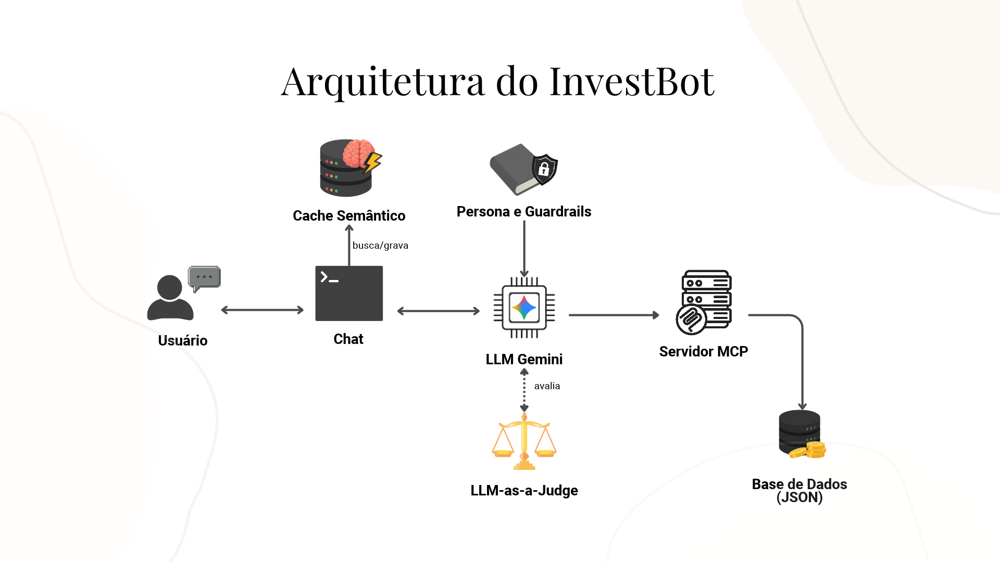

# InvestBot

[](https://www.python.org/)
[](https://ai.google.dev/)
[](https://modelcontextprotocol.io/)
[](https://www.trychroma.com/)
[](#avaliação)


Um sistema especialista conversacional voltado para finanças pessoais e investimentos na B3. Ele emula o raciocínio de um consultor financeiro certificado, auxiliando o usuário na recomendação de ativos conforme o  perfil de risco (suitability), sugere diversificação e explica regras tributárias de Imposto de Renda.


## Arquitetura
<p align="center">
  
</p>


### Ferramentas MCP

| Ferramenta | Funcionalidade |
|---|---|
| `listar_ativos` | Lista todos os ativos disponíveis, agrupados por categoria. |
| `consultar_tributacao` | Consulta tabela, alíquotas e isenções de Imposto de Renda. |
| `consultar_rentabilidade_risco` | Consulta rentabilidade, risco, liquidez e perfil recomendado. |
| `consultar_ativo` | Retorna a visão completa de um ativo. |
| `filtrar_por_perfil` | Lista os ativos indicados para Conservador, Moderado ou Arrojado. |

## Exemplos de perguntas

Você pode fazer perguntas em linguagem natural, por exemplo:

### Catálogo e perfil

- Quais ativos estão disponíveis na base?
- Quais ativos são indicados para um investidor conservador?
- Quais investimentos são recomendados para o perfil moderado?
- Quais ativos arrojados estão disponíveis?

### Ativos específicos

- O que é o Tesouro Selic?
- Quais são as características do CDB Banco BTG Pactual?
- Qual é a rentabilidade, o risco e a liquidez da LCI Banco Inter?
- Quero uma visão completa do ativo PETR4.

### Tributação

- Como funciona o Imposto de Renda do Tesouro Selic?
- Existe isenção de IR para a LCI Banco Inter?
- Como funciona a tributação dos rendimentos de FIIs?
- Qual é a alíquota de IR sobre o CDB?

### Comparações e objetivos

- Qual é a melhor opção da base para uma reserva de emergência?
- Qual é a diferença entre Tesouro Selic e CDB?
- Qual título pode proteger meu patrimônio contra a inflação?
- Quais ativos da base possuem liquidez diária?

As respostas são baseadas nos dados disponíveis em
`conhecimento/dados_investimentos.json`. Para perguntas sobre ativos, risco,
liquidez ou tributação, o assistente pode executar uma ou mais ferramentas MCP.

## Pré-requisitos

- Python 3.12 ou superior.
- Uma chave de API do Google Gemini.

## Execução

Instale as dependências:

```powershell
py -m pip install -r requirements.txt
```

Crie o `.env` a partir do arquivo de exemplo:

```powershell
Copy-Item .env.example .env
```

Edite o `.env` e informe sua chave:

```env
GOOGLE_API_KEY="sua_chave_google_aqui"
```

Obtenha uma chave no [Google AI Studio](https://aistudio.google.com/api-keys).

### Terminal 1: servidor MCP

Na raiz do projeto, execute:

```powershell
py ferramentas.py
```

O servidor ficará disponível em:

```text
http://localhost:8000/mcp
```

Esse endereço é um endpoint MCP e não deve ser aberto diretamente no navegador como uma página comum.

#### Inspeção das ferramentas MCP

```powershell
fastmcp inspect ferramentas.py
```

Com Node.js instalado, também é possível usar o
[MCP Inspector](https://github.com/modelcontextprotocol/inspector):

```powershell
npx @modelcontextprotocol/inspector
```

### Terminal 2: chat

Com o servidor ainda em execução, abra outro terminal na raiz do projeto:

```powershell
py chat.py
```

Para encerrar o chat, digite:

```text
sair
```

As ferramentas disponíveis estão descritas na tabela acima.

### Avaliação LLM-as-a-Judge

O script de avaliação usa `conhecimento/investimentos_menor.json`, destinado a conter
um conjunto reduzido de perguntas e respostas, normalmente quatro casos. Essa base
menor reduz o número de chamadas ao modelo, o tempo de execução e o consumo de
tokens durante o julgamento.

Execute em outro terminal:

```powershell
py julgamento.py
```

O arquivo menor precisa existir e conter registros válidos. Cada registro deve ter:

```json
{
  "pergunta": "Pergunta de exemplo",
  "resposta": "Resposta esperada de exemplo"
}
```

O julgamento também testa dois casos intencionalmente inadequados definidos em
`CASOS_INADEQUADOS`.

O fluxo usa um segundo contexto do Gemini para avaliar se as respostas são adequadas
e justificar o veredito. A base reduzida é recomendada para evitar consumo
desnecessário de tokens.

## Estrutura do projeto

```text
.
├── chat.py                         # Cliente MCP e interface do chat
├── ferramentas.py                  # Servidor MCP e ferramentas de consulta
├── julgamento.py                   # Avaliação do assistente
├── llm.py                          # Integração com o Google Gemini
├── cache.py                        # Cache semântico
├── requirements.txt                # Dependências Python
├── .env.example                    # Modelo da configuração da API
├── conhecimento/
│   ├── dados_investimentos.json    # Base de ativos usada pelas ferramentas
│   ├── investimentos.json          # Perguntas e respostas do conhecimento
│   └── investimentos_menor.json    # Base reduzida para julgamento
└── cache/                          # Dados persistidos do cache semântico
```